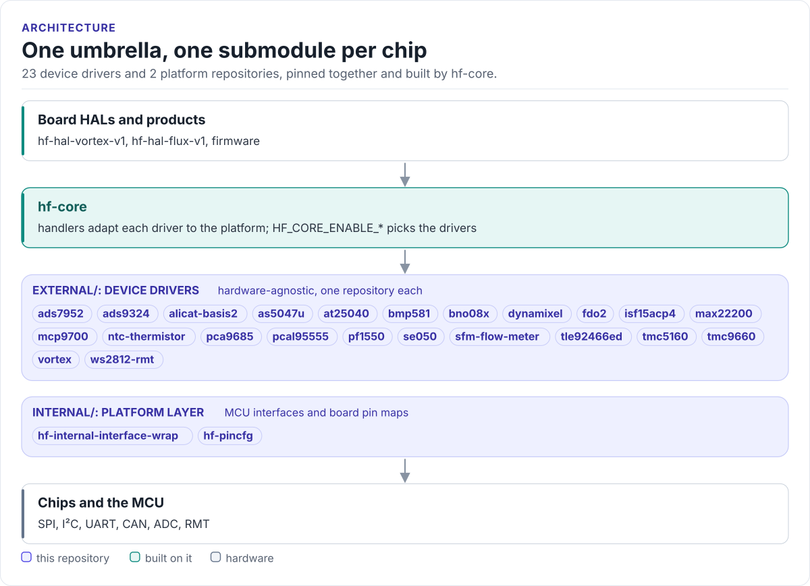

# HardFOC Core Drivers

Every HardFOC device driver and the platform layer they share, pinned together as git submodules: one repository to
add, one submodule per chip.

[](https://hardfoc.github.io/hf-core-drivers/)
[](LICENSE)

**Documentation: <https://hardfoc.github.io/hf-core-drivers/>**

<!-- figure: umbrella -->
<picture>
  <source media="(prefers-color-scheme: dark)" srcset="docs/diagrams/umbrella.dark.svg">
  
</picture>
<!-- /figure -->

## In 30 seconds

[hf-core](https://github.com/hardfoc/hf-core) carries this repository and builds only the drivers a board turns on:

```cmake
set(HF_CORE_MCU  "ESP32")
set(HF_CORE_RTOS "FREERTOS")
set(HF_CORE_ENABLE_TMC9660 ON)
set(HF_CORE_ENABLE_PCAL95555 ON)
include(path/to/hf-core/cmake/hf_core_build_settings.cmake)
```

## What it does

- Pins one commit of each device driver under `external/`: motor controllers, solenoid drivers, encoders, IMU,
  ADCs, sensors, expanders, PMIC, EEPROM, secure element.
- Pins the platform layer under `internal/`: `hf-internal-interface-wrap` (MCU interfaces) and `hf-pincfg` (board
  pin maps).
- Keeps every driver in its own repository, with its own tests and documentation site.
- Holds the shared [coding standards](CODING_STANDARDS.md).

## Install

```bash
git submodule add https://github.com/hardfoc/hf-core-drivers.git hf-core-drivers
git -C hf-core-drivers submodule update --init --depth 1 external/hf-tmc9660-driver internal/hf-pincfg
```

There are no build files here; each driver has its own CMake target and ESP-IDF component.

## Documentation

| | |
| --- | --- |
| [Driver catalogue](https://hardfoc.github.io/hf-core-drivers/latest/catalogue/) | A card per chip with bus and documentation site |
| [All drivers](https://hardfoc.github.io/hf-core-drivers/latest/drivers/) | The same list as one table |
| [Using the drivers](https://hardfoc.github.io/hf-core-drivers/latest/integration/) | Through hf-core or on their own |
| [Platform layer](https://hardfoc.github.io/hf-core-drivers/latest/internal/) | Interface layer and pin maps |
| [Updating submodules](https://hardfoc.github.io/hf-core-drivers/latest/submodules/) | Bump, check and add a driver |

## Tests

Each driver is tested in its own repository; this repository's CI checks the catalogue against `.gitmodules`:

```bash
hardfoc-docs check && mkdocs build --strict
```

## License

GPL-3.0; see [LICENSE](LICENSE).
