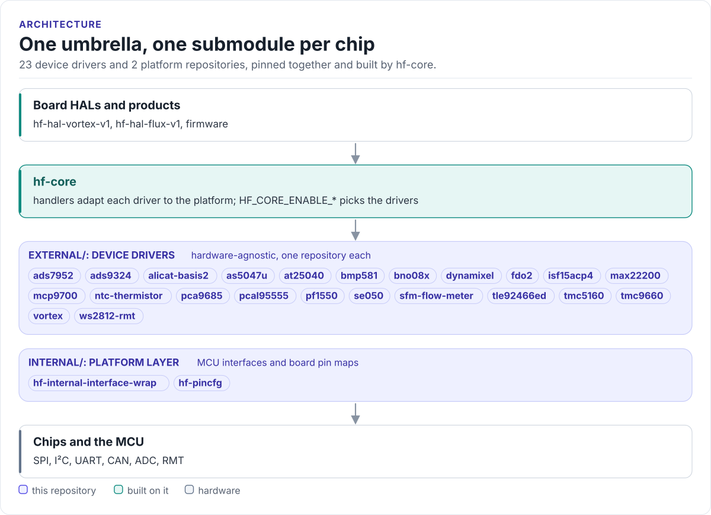

---
hide:
  - navigation
  - toc
---

HardFOC core library

# HardFOC Core Drivers

Every HardFOC device driver and the platform layer they run on, collected as git submodules at pinned commits.
One repository to add to a project; each driver keeps its own repository, tests and documentation site.

[Driver catalogue](catalogue.md){ .md-button .md-button--primary }
[Using the drivers](integration.md){ .md-button }
[Source on GitHub](https://github.com/hardfoc/hf-core-drivers){ .md-button }

A product needs a dozen drivers that must agree on one platform interface and move together.
`hf-core-drivers` pins a set of driver commits that build together, plus the two platform repositories they share:
the MCU interface layer and the board pin maps. [hf-core](https://github.com/hardfoc/hf-core) consumes it and
compiles only the drivers a board turns on.

<!-- figure: umbrella -->
<picture>
  <source media="(prefers-color-scheme: dark)" srcset="diagrams/umbrella.dark.svg">
  
</picture>
<!-- /figure -->

## What you get

- **One submodule per chip.** Motor controllers, solenoid drivers, encoders, IMUs, ADCs, sensors, expanders, PMIC,
  EEPROM and secure element. See the [driver catalogue](catalogue.md).
- **A platform layer.** `internal/hf-internal-interface-wrap` (MCU peripheral interfaces) and `internal/hf-pincfg`
  (board pin maps). See [Platform layer](internal.md).
- **Drivers with no platform code.** Each driver talks to a small interface class; the board provides it. See
  [How a driver is built](concepts.md).
- **Pinned, reviewed versions.** A submodule bump is a pull request here. See
  [Updating submodules](submodules.md).
- **One coding standard.** Naming, errors, memory and documentation rules shared by every driver. See
  [Coding standards](coding-standards.md).

## Where to go next

-   :material-view-grid-outline: **[Driver catalogue](catalogue.md)**

    ---

    A card per chip with its bus and documentation site.

-   :material-download-outline: **[Using the drivers](integration.md)**

    ---

    Add the umbrella, turn drivers on in hf-core.

-   :material-layers-outline: **[Platform layer](internal.md)**

    ---

    The interface layer and pin maps every driver builds on.

-   :material-source-branch: **[Updating submodules](submodules.md)**

    ---

    Bump a driver, check it, open the pull request.

